# cart253
> 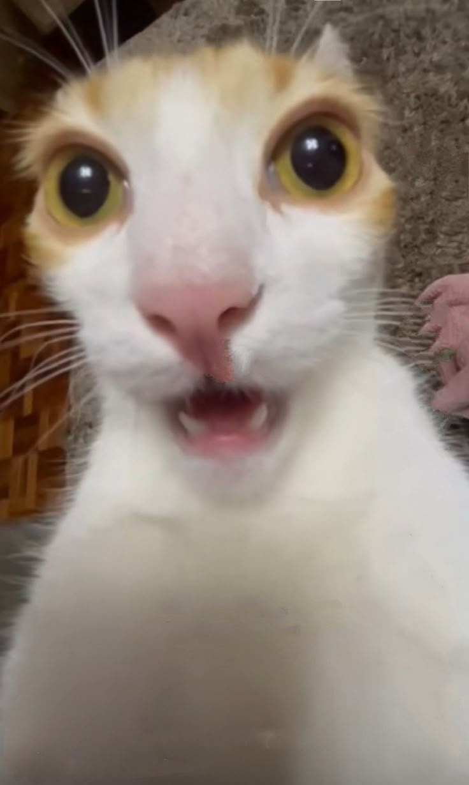

## Description

This is a repo containing a collection of short programing projects for my CART 253 course at Concordia University. Each are artistic oddities made primarily in HTML,CSS,JS suite.

## Journal

[Journal](./journal.md)

## Links

## Functions
<!-- Veteran Combat -->
>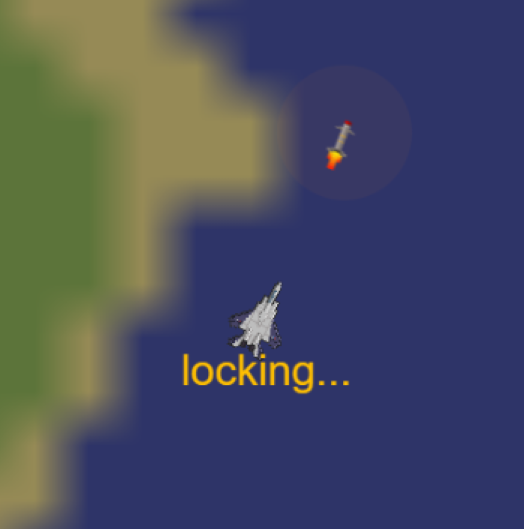
 
[Veteran Combat](./prototypes/functions/veteran-combat/index.html)
 
code:
[main](./prototypes/functions/veteran-combat/js/script.js), [classes](./prototypes/functions/veteran-combat/js/classes.js), [player-setup](./prototypes/functions/veteran-combat/js/player-setup.js), [terrain-script](./prototypes/functions/veteran-combat/js/terrain-script.js)

<!-- Nontendo Gameman -->
>
 
[Antfarm, for the Nontendo Gameman](./prototypes/functions/cartridges-generator/index.html)
 
code:
[main](./prototypes/functions/cartridges-generator/js/antfarm.js), [cartridge-code](./prototypes/functions/cartridges-generator/js/cartridge.js), [class](./prototypes/functions/cartridges-generator/js/class.js)

<!-- Spring physics -->
>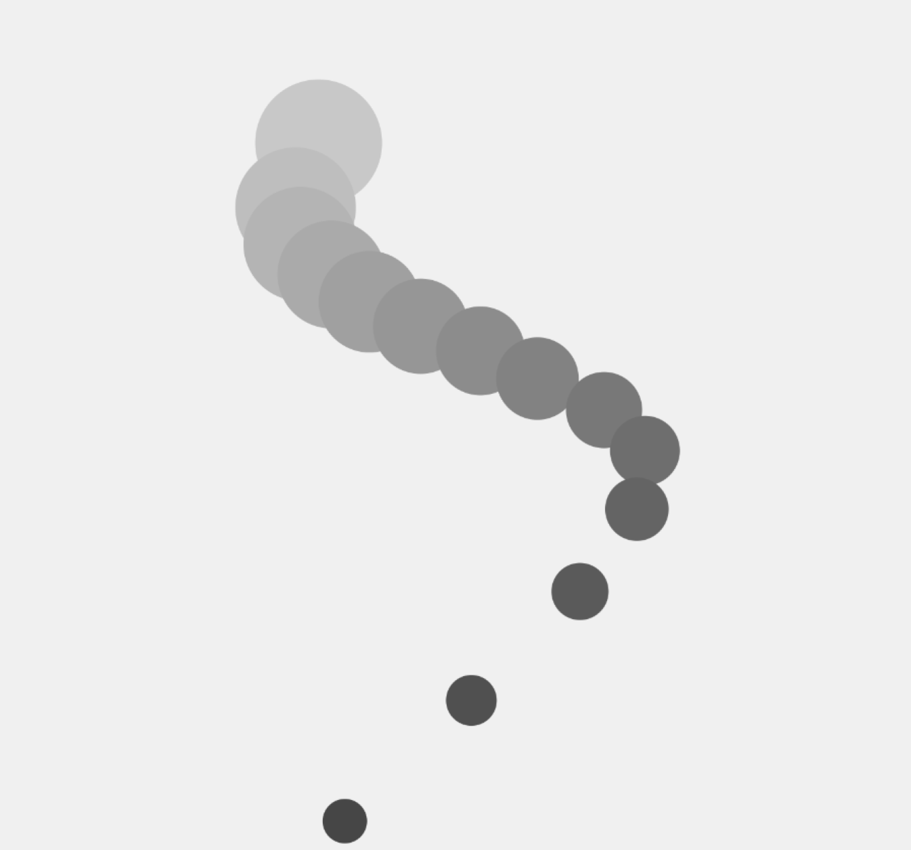
 
[Tail Simulation](./prototypes/functions/inverse-kinematics/index.html)
 
code:
[main](./prototypes/functions/inverse-kinematics/js/script.js), [class](./prototypes/functions/inverse-kinematics/js/class.js)

## Events
[Lose challenge](./topics/events/index.html)
[code](./topics/events/js/script.js)

<!-- Wizardry -->
>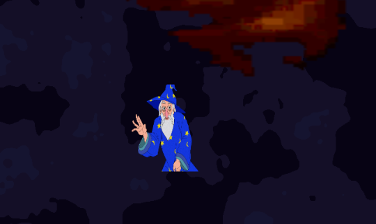
 
[Shadow Wizard Money Gang](./prototypes/events/wizardry/index.html)
 
code:
[main](./prototypes/events/wizardry/js/main-script.js), [background-generator](./prototypes/events/wizardry/js/terrain-script.js)

<!-- Obeese -->
>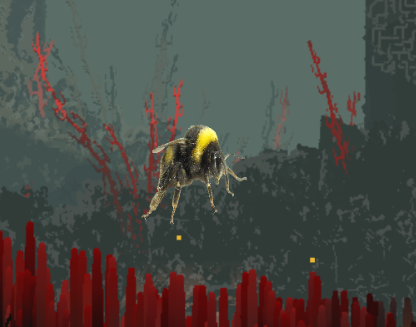
 
[Obeese](./prototypes/events/obeese/index.html)
 
[code](./prototypes/events/obeese/js/script.js)

<!-- Rookie Combat -->
>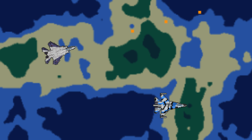
 
[Rookie Combat](./prototypes/events/rookie-combat/index.html)
 
code:
[main](./prototypes/events/rookie-combat/js/script.js), [classes](./prototypes/events/rookie-combat/js/classes.js)

### Conditionals
[Puck Challenge](./topics/conditionals/index.html)
[Code](./topics/conditionals/js/script.js)

>[Perlin Terrain](/prototypes/conditionals/perlin-terrain/index.html)
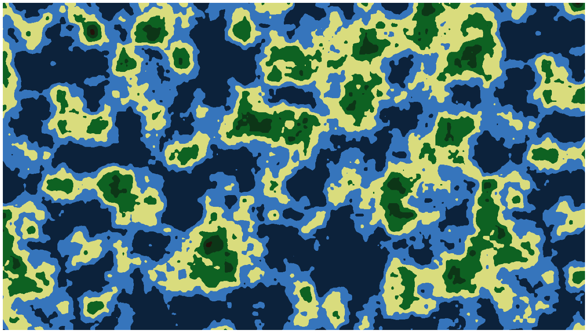
[code](./prototypes/conditionals/perlin-terrain/js/script.js)

>[Blue Sand Desert](./prototypes/conditionals/blue-sand-desert/index.html)
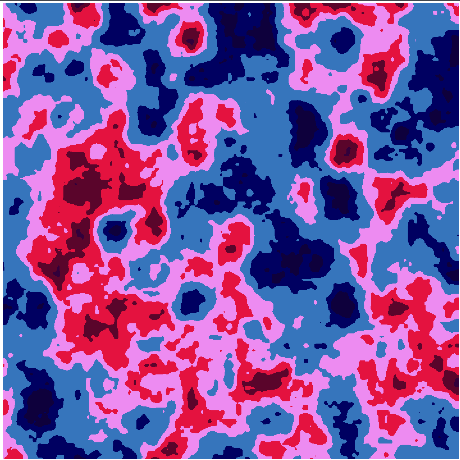
[code](./prototypes/conditionals/blue-sand-desert/js/script.js)

>[Procedural Explorer](./prototypes/conditionals/procedural-explorer/index.html)
**Controls: WASD**
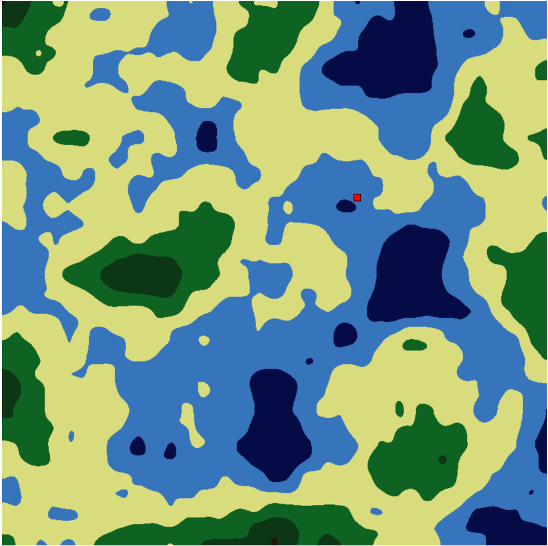
 
[code](./prototypes/conditionals/procedural-explorer/js/script.js)

### Variables
[Mr Furious](./topics/variables/index.html) (with Sawyer)
[Code](./topics/variables/js/script.js) 

>[Sisyfish](./prototypes/variables/sisyfish/index.html)
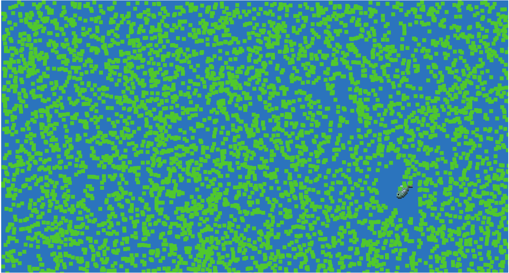
[code](./prototypes/variables/sisyfish/js/script.js)

>[Cambrian Explosion](./prototypes/variables/cambrian_explosion/index.html)
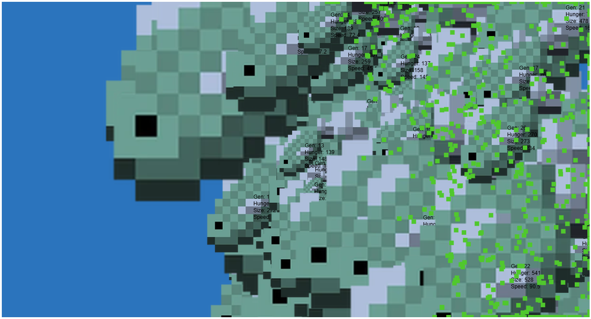
[code](./prototypes/variables/cambrian_explosion/js/script.js)

>[Fihmulation](./prototypes/variables/fihmulation/index.html)
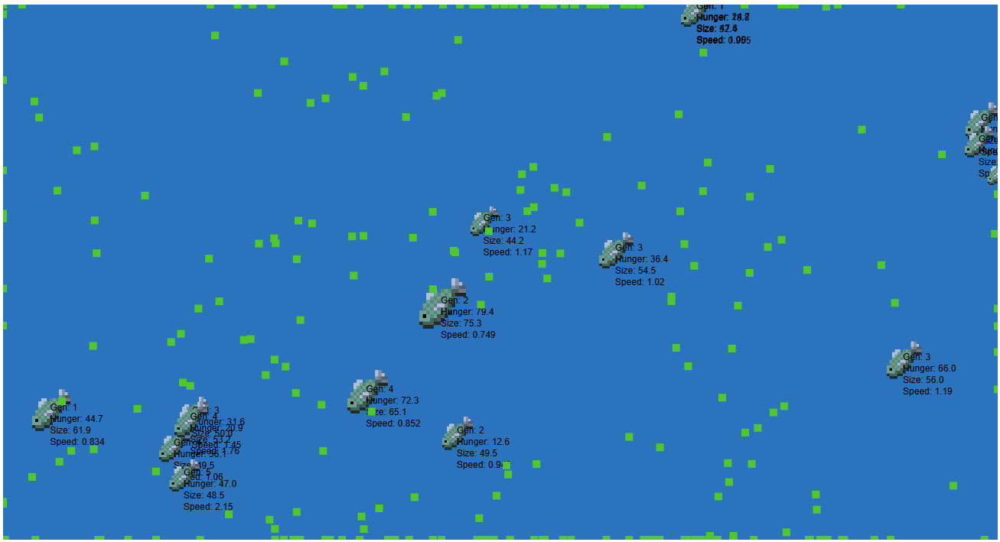
[code](./prototypes/variables/fihmulation/js/script.js)

### Instructions
[Instructions](./topics/instruction-challenge/index.html)
[Code](./topics/instruction-challenge/js/script.js)

>[Vaporwave](./prototypes/instructions/vaporwave/index.html)

[code](./prototypes/instructions/vaporwave/js/script.js)

>[Sky Full Of Stars](./prototypes/instructions/sky_full_of_stars/index.html)
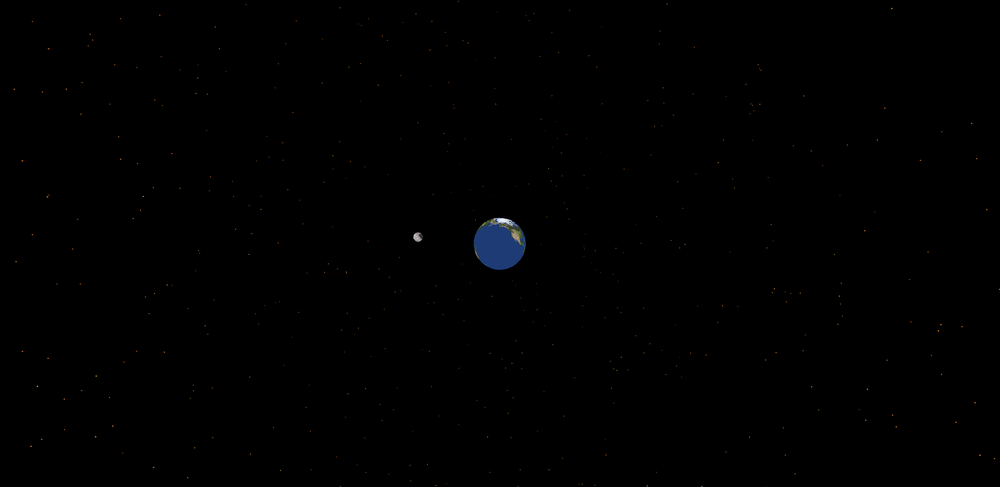
[code](./prototypes/instructions/sky_full_of_stars/js/script.js)

>[Impending](./prototypes/instructions/impending/index.html)

[code](./prototypes/instructions/impending/js/script.js)

### Hello World
[hello_world](./topics/hello_world/index.html)
[Code](./topics/hello_world/js/script.js)

## License

This bit should include the license you want to apply to your work. For example:

> This project is licensed under a Creative Commons Attribution ([CC BY 4.0](https://creativecommons.org/licenses/by/4.0/deed.en)) license with the exception of libraries and other components with their own licenses.