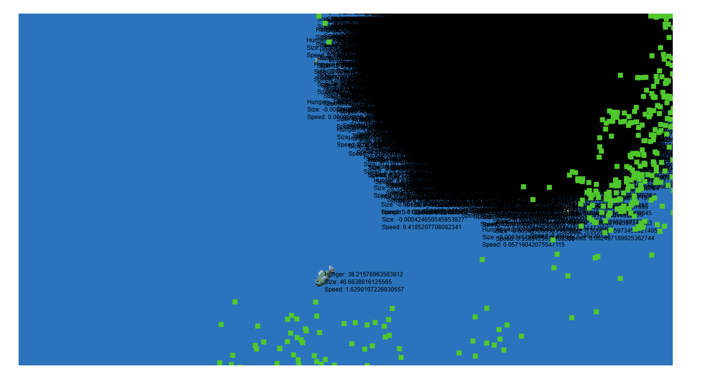
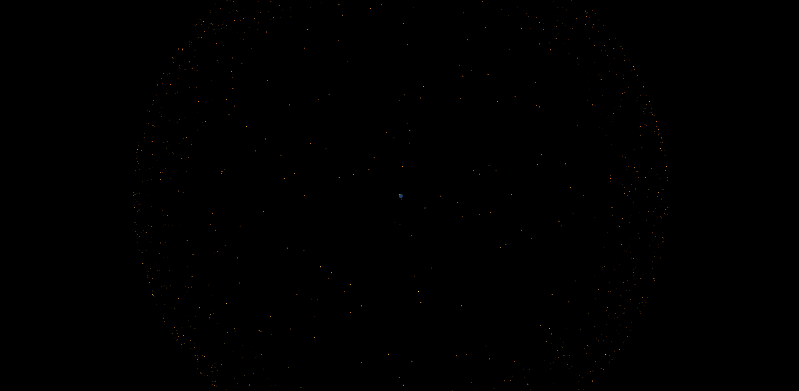
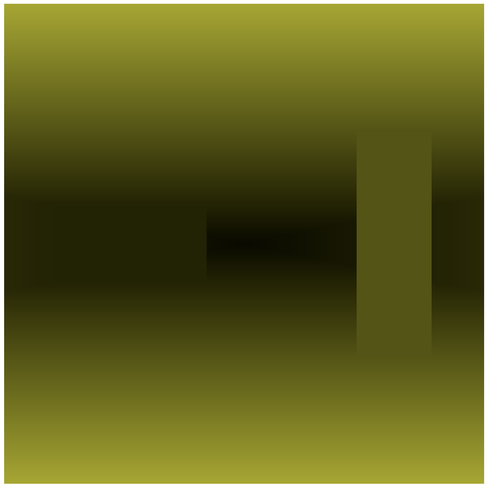

# Reflective Journal

## 2026-10-27
> I've recently been interested in messing with inverse kinematics, so I decided on making a simulation tail-like appendage. For this prototype I created an array of ellipses that are coupled to eachother, are affected by gravity, and have additional influence on their neighbors. While simple in concept, the physics are percisely tuned based on my initial inspriation.
> In its current state, the appendage only moves from its base, while the rest follow. Since the sim uses a combination of Hooke's law and the critical damping formula, the appendage feels very spring like, and not as much like a tail as I imagined. Perhaps I'll do more research in what physics model to use in the future.
>[Tail Simulation](./prototypes/functions/inverse-kinematics/index.html)
>

## 2026-10-24
> My inspiration for this prototype was of old gameboy games, and how, at that time, game states could now be saves in a piece of hardware with its own memory. My prototype consists of a simple grid-based game where you can place and remove cells from the sandbox. What sets it appart however, is how you can choose to download a "cartridge" (which is essentially an empty JSON save file), and "dock" it to the webpage. Upon clicking "eject", all changes made to the sandbox will be saved into the "cartridge", and can be reloaded into the sketch at any later time, even after refreshing the page. 
> NOTE: If the act of docking the save file is blocked by your browser, you can play in stateless mode, which is essentailly the same sandbox game without the saving features.
> This is a personal favorite of mine, as it facilitates persistent and personalized sandbox instances to mess around with.
>[Antfarm, for the Nontendo Gameman](./prototypes/functions/cartridges-generator/index.html)
>

## 2026-10-23
> I wanted to improve upon my previous prototype _Rookie Combat_ (see prev entry), as there were several things I wasn't happy with. After in-class testing, I realized that my keyboard only allowed up to 5 or so inputs at a time, and since there were many controls for multiplayer, some of your inputs would get eaten. Additionally, with how small the bounds of the game were, as well as how much realism I coded into the flight physics, there was little room for maneuvering. I decided I wanted to instead make a single player experience, and a procedurally generated map, with the player in the center, and all other objects moving relative to it. The procedural terrain alone was far too ambitious, as even though I already experimented with it in another project, making transitions between terrain chunks was very difficult to do seamlessly, so I sacrified a lot of the resolution of the background. Even now there are visible chunk borders sometimes. As of the current build, enemy fighters do not move in relation to the player, instead just flying across the canvas. Ill need to account for this later if I'm to improve on this prototype. For now though, flighing around is fairly smooth and satisfying.
>[Veteran Combat](./prototypes/functions/veteran-combat/index.html)
>

## 2026-10-19
> For my final prototype of the events module, I wanted to make a local multiplayer game to play with buddies. This one can be played with 2, and potentially up to infinite players, as long as your keyboard has enough keys. Although for now ill stick to 2 players for this prototype, adding more is as simple as declaring a new player object in setup, along with their prefered control scheme.
> Each player can increase/decrease their throttle, turn left or right relative to their aircraft, as well as fire bullets.
> I leaned more into realism for the flight physics. Each aircraft has energy which is needed to make turns and depletes when turning, accelerates when moving in a straight line, and carries some momentum on turns. With this configuration, energy and momentum is a resource you need to manage in order to out-maneuver you opponent. My vision was for it to be more strategic, rather than arcadie.
> Tip: Your energy regenerates when moving straight, and will regenerate faster depending on your throttle!
>[Rookie Combat](./prototypes/events/rookie-combat/index.html)
>

## 2026-10-15
> This prototype consists of a silly bee simulator, where you collect pollen and grow as a result, becoming heavier. 
> The main focus was to make a control scheme that felt smooth at first, but purposefully clunky later on. Also for dynamic buzzing sound pitch influenced on your size, if you're currently flying upwards, falling, or grounded.
> Pollen spawns randomly and will bounce off the walls if it attempting to move out of bounds, much like the player.
> At a certain weight it becomes impossible to fly, which is why pressing **SPACE** will shake the bee, ridding it of excess pollen.
> The background is taken from my favorite game of all time _Rain World_!
>[Obeese](./prototypes/events/obeese/index.html)
>

## 2026-10-13
> I wanted to make a wizard game, with different spells that the player can use, each with their own strengths. This was far more ambitious than i was capable of, since i needed to make 3 more prototypes. The final product isnt quite perfect, and i definitely fell victim to scope creep. The main focus was supposed to be the spells, with fireball being your main source of splash damage at a steep mana cost, magic missile as your spammable weak attack, and freeze as your utility spell for handling large waves of enemies. Overall the spells came out great, however I wish there was more enemy class variety. Perhaps thats for a future implementation. For now skeletons rush at you from the screen borders, spawning faster and faster as the game progresses.
> I still wasnt quite finished with perlin noise. I thought it'd make a great background for the wizard game with muted, cave-like colors.
>[Shadow Wizard Money Gang](./prototypes/events/wizardry/index.html)
>

## 2026-10-6
> With the last map being so sandy, I figured I'd lean more into that direction but with a flavour of fantasy. I added support for tweaking the colors of the map in hex, as opposed to cryptic looking rgb values of known colors. I added a langer range of sand and chose wacky colors. The colors almost look like a sort of heat map, or as if some kind of posterization filter was added to the terrain.
>[Blue Sand Desert](./prototypes/conditionals/blue-sand-desert/index.html)
>

> For the last protoype, I wanted to make an explorable terrain map with a movable player. I'm not going to bore with details since its mostly technical. What I can say is I wouldve liked to feature some sort of goal to turn this piece into a game, but due to time concerns there isn't much to do other than endlessly wander the terrain. Good thing it's infinite!
**Player can be controlled with WASD!**
>[Procedural Explorer](./prototypes/conditionals/procedural-explorer/index.html)
> 

## 2026-10-3
> I had the idea to use perlin noise to generate procedural images in p5.js. I've done some work on this subject previously in unity engine, but I was curious about how that would look like in p5. My first working iteration came out farily well. I mimicked previous projects of mine which mostly featured an image akin to tropical terrain, with an even amount of land and ocean, and strong emphasis on the sandy areas as opposed to a map of earth in real life. A more realistic map might have more water and less or no sand, but perhaps that for a future prototype. As of now, the only parameters that can modify the map are the outer bounds, as well as the scale of the noise. There are some elements I'd like to improve on later, such as adding support for layering octaves of perlin noise, and allowing control over parameters such as persistence and lacunarity for finer details. On a side note, I've noticed that noise generates repeating patterns at a large scale. Unless I'm missing something I'm not aware of, this differs from the noise function in the unity engine, as it produces a much more natural pattern, although I could be missing something here.
>[Perlin Terrain](./prototypes/conditionals/perlin-terrain/index.html)
>

## 2026-09-28
> I decided to embrace the chaos and created a version of the basic fish simulation idea but with boosted mutation rates and algae spawns. This Leads us to an environment akin to the Cambrian Explosion.
>[Cambrian Explosion](./prototypes/variables/cambrian_explosion/index.html)
>

## 2026-09-27
> Working on the Mr. Furious challenge made me realise the potential p5 holds in making a simulation type of scene. I designed a rudimentary version of what I'd later expand into evolution simulators, with a simple Sisyphean fish that endlessly eats algae for all of eternity. I say its eternal, since in theory each individual algae has a very small chance to duplicate, which can lead to a real eternal ordeal given enough of them on screen.
>[Sisyfish](./prototypes/variables/sisyfish/index.html)
>
> With this basic system allowing objects to be stored in memory and moved around, I decided experimenting with species reproduction by allowing fish to reproduce when they've filled their stomachs. This went horribly wrong for a while, leading to wars between fish and algae populations attempting to overpower the other.
>
> After much trial and error, I finally bit the bullet and manually capped the amount of algae that can spawn in a given region, making the simulation play out much more predicatbly. Perhaps I'll implement a more intricate system for flattening algae population at high concentrations later, but this will do for now.
>[Fihmulation](./prototypes/variables/fihmulation/index.html)
>
> This iteration behaves more like a rudimentary evolution simulator, mimicking the process of natural selection by creating competition for limited food resources, as well as allowing fish to reproduce with a chance of random mutations being bestowed to their offspring. The Fihmulation is mesmerizing.

## 2026-08-22
> After completing the second challenge, I had a working earth and moon orbit model that I wished to take further.
> [Instructions Challenge](./topics/instruction-challenge/index.html)

> My first idea was to create a simple skybox and apply it to the scene.
> 
> This looked alright, but i really wanted distant stars to be visible, and painting a skybox full of them would prove too tedious...
> [Vaporwave](./prototypes/instructions/vaporwave/index.html)

> So, for my second prototype I decided I'd manually place spheres in the sky with a texture of our sun wrapping them. Manually placing them gave me much more control over fine tuning the distance, size, size randomization, amount, etc... to fit my vision.
> 
> I really liked how the complex sun texture made the stars twinkle yellow and orange as I scrolled around the viewport.
> 
> Randomizing the star placement in a sphere around the earth also creates cool effect!
> [Sky Full Of Stars](./prototypes/instructions/sky_full_of_stars/index.html)

> Lastly i wanted a piece that captured the truly incomprehansible size of celestial bodies. So, using the sun texture form before, I place a giant sun right next to the earth. I made the model to scale for the most part, with the sun being 109 times larger than the earth.
> 
> Overall, the scene makes our sun appear very imposing, almost like it's about to swallow the earth.
> [Impending](./prototypes/instructions/impending/index.html)

## 2026-08-10
> Im fairly familair with github already, however working on MAC has been a pain for me, but hopefully that will be temporary. For now i editted the sample project to feature the backrooms.
> 
> [Backrooms](./topics/hello_world/index.html)

